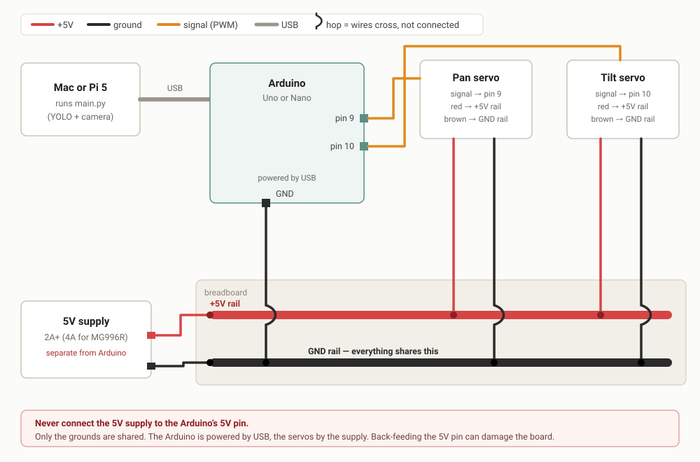

# Hooking up the Arduino

Step-by-step wiring and setup for the pan/tilt rig, written assuming no prior
Arduino experience. Work through it in order — each stage is testable on its own,
so when something breaks you know which stage caused it.

The sketch lives in [`arduino/pan_tilt/pan_tilt.ino`](arduino/pan_tilt/pan_tilt.ino).

---

## What you need

| Item | Notes |
| --- | --- |
| Arduino board | Uno or Nano. An ESP32 works too but pin numbers differ. |
| USB cable | Uno uses USB-B (printer cable), Nano usually mini- or micro-USB. Must be a **data** cable, not charge-only. |
| 2 servos | SG90 for bench testing; MG996R or similar for anything that moves a real load. |
| 5V power supply | **Separate from the Arduino.** 2A minimum for two SG90s, 4A+ for two MG996Rs. |
| Breadboard + jumper wires | Needed to join three grounds together. |
| Pan/tilt bracket | Optional, but the two servos must be mechanically coupled somehow. |

### Why a separate power supply

This is the one thing most likely to waste your afternoon. A servo under load
can briefly draw an amp or more. The Arduino's 5V pin cannot supply that — the
voltage sags, the board resets, and your program appears to randomly restart.
Powering servos from the Arduino works just well enough on an unloaded SG90 to
convince you it's fine, then fails once there's weight on the horn.

---

## Stage 1 — Install the software

1. Download the Arduino IDE from <https://www.arduino.cc/en/software> (version 2.x).
2. Install and open it.
3. Plug the Arduino into your computer with the USB cable. A power LED should
   light up.

No wiring yet. Just the board and the USB cable.

---

## Stage 2 — Upload the sketch

1. In the IDE, open `arduino/pan_tilt/pan_tilt.ino` from this repo
   (**File → Open**).
2. **Tools → Board** → pick your exact board (e.g. "Arduino Uno").
3. **Tools → Port** → pick the port that appeared when you plugged in. On macOS
   it looks like `/dev/cu.usbmodem1101`. If several are listed, unplug the board,
   check which one disappears, plug it back in.
4. Click the **Upload** button (right-arrow, top left).

You should see "Done uploading." The `Servo` library is bundled with the IDE, so
there is nothing extra to install.

> **If upload fails:** the most common causes are the wrong board selected, the
> wrong port, or a charge-only USB cable. On a Nano clone you may also need
> **Tools → Processor → "ATmega328P (Old Bootloader)"**.

**Checkpoint:** the sketch uploaded. Nothing is wired yet, so nothing will move.

---

## Stage 3 — Talk to the board by hand

This proves the board works before Python is anywhere near it.

1. Open **Tools → Serial Monitor**.
2. Set the baud rate (bottom right) to **115200**. This must match the sketch.
3. Set the line ending dropdown to **New Line**. ← *Easy to miss.* The sketch
   waits for a newline character to know a command has ended. With "No Line
   Ending" selected, nothing you type will ever do anything.
4. Type `P120T060` and press Enter.

The board should reply:

```
ok 120 60
```

**Checkpoint:** you get `ok` back. If you do, the board, cable, port, baud rate
and command format are all confirmed working. Servos still aren't connected, so
nothing moves.

---

## Stage 4 — Wire the servos

**Unplug everything first** — USB and the power supply.

Each servo has three wires:

| Colour (typical) | Meaning | Goes to |
| --- | --- | --- |
| Brown or black | Ground | Breadboard ground rail |
| Red | +5V power | External supply's +5V |
| Orange, yellow or white | Signal | Arduino pin 9 (pan) or pin 10 (tilt) |

Wire it like this:



Three connections that matter:

1. **Servo red wires → external supply +5V.** Never to the Arduino's 5V pin.
2. **Servo signal wires → Arduino pins 9 (pan) and 10 (tilt).**
3. **Grounds tied together:** servo grounds, the supply's ground, *and* an
   Arduino `GND` pin all connect to the same breadboard ground rail.

That third one is non-obvious and essential. A PWM signal is a voltage measured
*relative to ground*. If the Arduino and the servos don't share a ground
reference, the servos receive a meaningless signal and will twitch, buzz, or sit
there doing nothing. Symptoms look exactly like a broken servo.

> **Do not** connect the external supply's +5V to the Arduino's 5V pin. Only the
> grounds get joined. Back-feeding the 5V pin can damage the board or your
> computer's USB port.

---

## Stage 5 — Power up and retest by hand

1. Plug in the external 5V supply. Both servos should jump to centre (90°),
   because that is what the sketch's `setup()` commands.
2. Plug in USB.
3. Open the Serial Monitor again (115200, **New Line**).
4. Type `P120T060` and press Enter.

Both servos should move, and you should see `ok 120 60`.

**Checkpoint:** servos move on command. The hardware is now fully proven.

> **If the servos buzz, jitter, or hum without moving properly:** ground is not
> shared (see Stage 4), or the supply cannot deliver enough current.
>
> **If the board resets** when a servo moves (the serial monitor reconnects or
> prints garbage): the servos are drawing from the Arduino rather than the
> external supply, or the supply is undersized.

---

## Stage 6 — Hand over to Python

1. Close the Serial Monitor. **Only one program can hold the port at a time** —
   if the IDE has it open, Python can't connect, and vice versa.
2. Run the vision code:

   ```sh
   source .venv/bin/activate
   python main.py
   ```

Look for this line at startup:

```
[board]   connected on /dev/cu.usbmodem1101
```

If instead you see `[board] no serial port found, printing angles only`, the
program is running fine but talking to nobody — check the USB cable and that the
Serial Monitor is closed. You can also set `SERIAL_PORT` near the top of
`main.py` to the exact port instead of relying on autodetection.

As a person is detected, you'll see the rig steering:

```
[rig]     pan 100 (+10.0)  tilt  95 (+5.4)
```

and the same values go to the servos as `P100T095`.

---

## Stage 7 — Calibrate

Three values in `main.py` are placeholders until measured on your actual rig.

**`PAN_SIGN` / `TILT_SIGN`** — if the rig turns *away* from the target and runs
to its limit, flip the relevant one from `1` to `-1`. Which is correct depends
purely on how your servos are mounted, so there is no way to know in advance.
This is the first thing to check if behaviour looks wrong.

**`FOV_PAN_DEG` / `FOV_TILT_DEG`** — the camera's field of view in degrees.
Measure it: centre an object in frame, then pan until it sits at the very edge.
Double the angle you travelled, and that's the horizontal figure. Repeat
vertically for tilt.

**`GAIN`** — how much of the remaining error is corrected per update. Start at
`0.6`. Lower it if the rig overshoots and oscillates around centre; raise it if
it creeps toward the target too slowly.

---

## Things worth not learning the hard way

- **Don't force the servo horn by hand** while it's powered. You're fighting the
  motor and can strip the gears.
- **Respect the limits.** Cheap servos don't truly reach 0–180°; if yours buzzes
  and strains at an extreme, narrow `PAN_LIMITS` / `TILT_LIMITS` in `main.py`.
- **Servos twitch on power-up.** Normal. Don't mount anything fragile where a
  sudden jump would break it.
- **Uploading while servos are powered** can cause a jerk as the board resets.
  Harmless, but startling.
- **Unplugging USB mid-run** leaves Python writing to a dead port. Stop the
  script first.

---

## Troubleshooting

| Symptom | Likely cause |
| --- | --- |
| Upload fails | Wrong board/port selected, or a charge-only USB cable |
| Typing in Serial Monitor does nothing | Line ending not set to **New Line**, or baud isn't 115200 |
| Serial Monitor shows garbage | Baud rate mismatch |
| Servos buzz but barely move | Grounds not shared, or supply undersized |
| Board resets when servos move | Servos powered from the Arduino instead of the external supply |
| `no serial port found` | Serial Monitor still holding the port, or cable not connected |
| Rig runs to its limit instead of settling | `PAN_SIGN` / `TILT_SIGN` wrong for your mounting |
| Rig oscillates around centre | `GAIN` too high |
| Nothing is detected at all | Camera index wrong — try `python main.py 0` |
